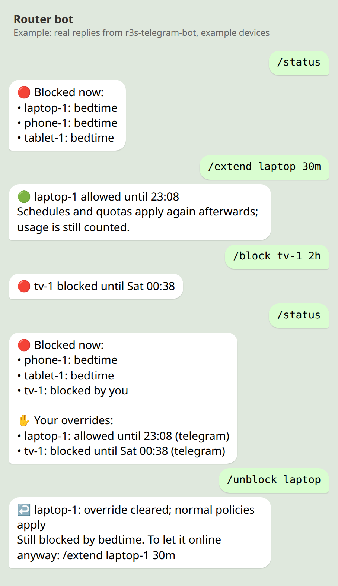
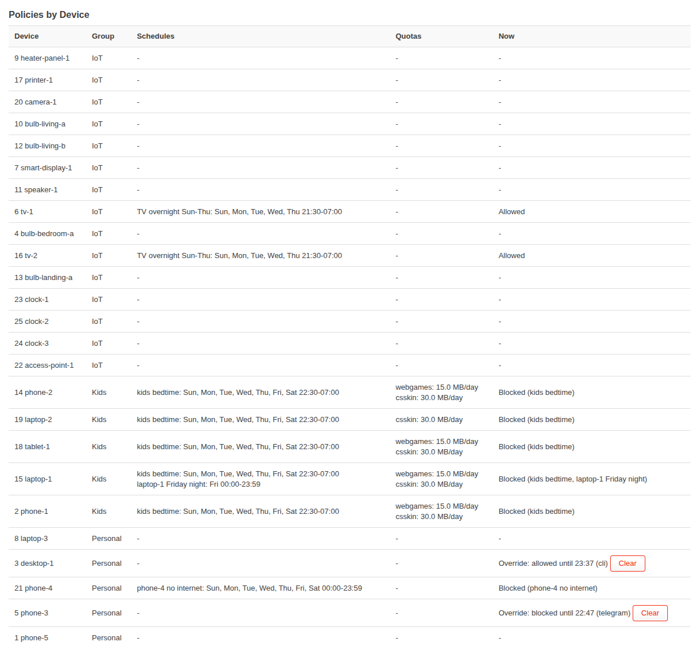
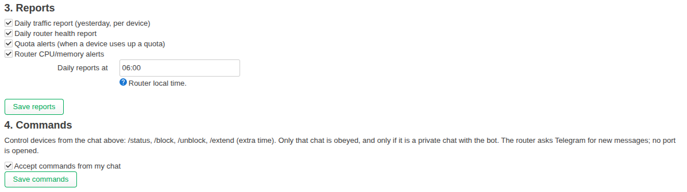

# openwrt-traffic-quota

[](https://github.com/raymondlmy/openwrt-traffic-quota/actions/workflows/ci.yml)

Per-device traffic accounting, internet schedules and per-site daily quotas
for OpenWrt routers, over **IPv4 and IPv6**.

- **See who used what.** Every forwarded byte is counted per device (by MAC
  address), kept as hourly history in SQLite, and summarised by `bw-rpt`.
- **Schedules.** Block a device's whole internet access on chosen days and
  times, e.g. a TV overnight or a child's devices at bedtime.
- **Per-site quotas.** Give a device a daily budget for a set of domains, e.g.
  30 MB of a games site. When it's used up, only that device/site pair is
  blocked until midnight.
- **Telegram reports** (optional): a daily traffic report, quota alerts and
  router-health alerts, set up from LuCI. See [TELEGRAM.md](TELEGRAM.md).
- **Telegram commands** (optional, off by default): from your phone, block a
  device, give it extra time past its schedule or quota, or see what is
  blocked and why:

  ```
  /status
  /block living room tv 30m   /block tablet          (until /unblock)
  /extend laptop 30m          /extend laptop 23:00   (ends by itself)
  /unblock laptop
  ```

  The router polls Telegram over outbound HTTPS, so **no port is opened**.
  Only your private chat is obeyed. An override affects one device across
  all its policies and shows on the LuCI page with a Clear button. Details in
  [TELEGRAM.md](TELEGRAM.md#commands-block-unblock-and-extra-time).
- **Per-device overrides** from the command line too:
  `r3s-policy override --device ID --action block|allow [--minutes N]`,
  `r3s-policy clear-override --device ID`, `r3s-policy overrides`.
- **LuCI pages** (Services → Traffic Quotas, Services → Telegram Reports) to
  register devices, approve new MAC addresses, edit policies and set up
  Telegram. Read-only LuCI users can view but not change anything.

## Screenshots

| Telegram commands | LuCI: Policies by Device |
|---|---|
|  |  |



Device names in the screenshots are examples. The chat shows the bot's real
replies, generated by its code on example data.

| Package | Contents |
|---|---|
| **`r3s-accounting`** | collector, reports (`bw-rpt`), policy evaluator, `r3s-policy` CLI |
| **`luci-app-r3s`** | the two LuCI pages |
| **`r3s-accounting-telegram`** | Telegram reports and alerts, `r3s-telegram-setup`, the `r3s-telegram-bot` command service (optional) |

The `r3s` names are historical: the project started on a NanoPi R3S. Nothing
in it is specific to that board.

## How it works

```
LAN devices ──► nftables (inet r3s_accounting)  counts bytes per IP and per IP→destination
             ──► nftables (inet r3s_policy)      drops/rejects blocked devices and pairs
                     ▲                 │
                     │ sets            │ counters, every 60 s
               r3s-policy-evaluator   collector.py ──► SQLite (persistent storage)
                     ▲                 │                   ▲
                     └──── policies ◄──┴── IP → MAC ◄──────┘ DHCP leases + neighbour table
```

- **Measurement only, never routing.** Both nft tables sit beside fw4's table,
  at priorities just before fw4's forward chain. The accounting table never
  accepts or drops anything.
- **Identity is the MAC address.** IPv4 addresses are mapped through DHCP
  leases, IPv6 addresses through the neighbour table. IPv6 blocks match the
  **MAC**, so devices that rotate temporary IPv6 addresses stay blocked.
- **Per-site quotas need DNS evidence.** A destination IP is only charged to a
  site's quota if AdGuard Home recently answered that device's query for the
  site with that IP. This avoids charging unrelated traffic that shares a CDN.

## Requirements

### Tested hardware

| | |
|---|---|
| Router | **FriendlyElec NanoPi R3S**: Rockchip RK3566, 4 x Cortex-A55 at 1.8 GHz, 1 GB RAM, 16 GB microSD (ext4) |
| OpenWrt | 25.12.5, rockchip/armv8 |
| Network | about 25 devices; IPv4 and IPv6; AdGuard Home with a 14-day query log |
| Measured | policy check ~14 s CPU per minute (peak 25 MB RAM); Telegram bot 11 MB RAM; database ~185 MB for 14 days; AdGuard Home ~230 MB RAM |

The packages are architecture-independent (Python, shell and JavaScript), so
they install on any OpenWrt 25.12 target. Other boards are untested.

### Recommended system

| | Minimum | Recommended |
|---|---|---|
| OpenWrt | **25.12** (apk, firewall4). 24.10 and older (opkg) are not supported. | latest 25.12.x |
| CPU | any 64-bit ARM or x86 | multi-core ARMv8 or x86. Slow single-core (older MIPS) routers may not finish a policy check each minute. |
| RAM | 256 MB without AdGuard Home | 512 MB; **1 GB with AdGuard Home** |
| Free space on `/` | 30 MB (Python and the packages use ~17 MB) | 100 MB |
| Database storage | **Persistent storage that isn't the router's flash**: SD card, eMMC, USB or SSD. Written every minute. | 1 GB free (grows ~10-15 MB per day with ~25 devices; 14 days kept) |

Typical single-board computers (NanoPi, Raspberry Pi, x86 mini PCs) qualify.
Most 16-128 MB flash routers don't: Python alone does not fit, and the
database would wear out the flash.

Also needed:

- **Firewall flow offloading off.** Offloaded connections skip nftables, so
  they would be neither counted nor blocked. The installer warns if it's on.
- **Devices reach the router with their own MAC.** Wi-Fi access points must be
  in bridge mode, not routing/NAT.
- **AdGuard Home is optional.** Only per-site quotas need it, with its query
  log enabled. Accounting, reports, schedules and whole-device blocks work
  without it.

### Dependencies

`apk` installs these automatically from the official OpenWrt feeds.

| Package | Depends on | Notes |
|---|---|---|
| `r3s-accounting` | `python3`, `sqlite3-cli`, `nftables-json` | `python3` pulls in its standard modules (`python3-light`, `python3-sqlite3`, `python3-urllib`, `python3-openssl`, ...), about 16 MB installed. Also uses `firewall4`, `procd`, `uci` and busybox, which every OpenWrt image has. |
| `luci-app-r3s` | `luci-base`, `rpcd`, `r3s-accounting` | Already present on images with LuCI. |
| `r3s-accounting-telegram` | `curl`, `ca-bundle`, `r3s-accounting` | Optional. |
| *(optional)* `adguardhome` | | For per-site quotas. See [INSTALL.md](INSTALL.md#3-optional-adguard-home-for-per-site-quotas). |
| *(optional)* `block-mount`, `kmod-usb-storage`, `kmod-fs-ext4`, `e2fsprogs` | | Only to keep the database on a USB drive. |

## Limitations

- **New or randomised MACs** are not covered by policies until you approve them
  on the LuCI page (they appear under *Unresolved MACs*).
- **Per-site quotas are DNS-based.** Clients using their own DNS-over-HTTPS
  bypass AdGuard and so are not charged. Block DoH in AdGuard if that matters.
- **Counters are sampled every 60 s.** A quota can overshoot by up to about a
  minute of traffic before the block applies.
- **Blocks are emptied on a firewall reload** until the evaluator's next pass,
  up to 60 s later.
- **IPv6 privacy addresses** are attributed through the neighbour table. An
  address that has already left that table when it is sampled counts as
  *unresolved*.

## Quick start

On the router (OpenWrt 25.12+), as root:

```sh
wget -qO /tmp/install.sh https://raw.githubusercontent.com/raymondlmy/openwrt-traffic-quota/main/install.sh
sh /tmp/install.sh --check     # optional: checks this router, changes nothing
sh /tmp/install.sh             # installs the latest release
```

The installer checks the OpenWrt version, free space, RAM, where the database
will live and flow offloading. It then downloads the release packages,
verifies their SHA-256 checksums and installs them with `apk`, which fetches
the dependencies. Options: `--no-luci`, `--no-telegram`, `--version 0.6.1`,
`--from DIR` (offline, local `.apk` files and `SHA256SUMS`). Running it again
upgrades; your devices, policies, history and settings are kept.

The packages are not signed with an OpenWrt key, so `apk` needs
`--allow-untrusted`. The installer does this only after the checksum check.
To build the packages yourself instead, see [INSTALL.md](INSTALL.md), which
also covers preparing an SD card and setting up AdGuard Home.

Then open **Services → Traffic Quotas** in LuCI, or:

```sh
r3s-policy devices                      # registered devices
r3s-policy unresolved                   # MACs seen but not yet assigned
r3s-policy add-device --name laptop-1 --group Kids --mac aa:bb:cc:dd:ee:ff   # r3s-policy groups
r3s-policy add --name "bedtime" --type schedule --service internet \
    --days 0,1,2,3,4 --start 1320 --end 420 --devices 1      # 22:00-07:00 Sun-Thu
r3s-policy add --name "games" --type service_quota --service custom \
    --domains example-games.com --quota 30000000 --devices 1  # 30 MB/day
bw-rpt daily                            # today's usage per device
```

## Configuration

All settings live in `/etc/config/r3s-accounting`.

| Option | Default | Meaning |
|---|---|---|
| `groups` | `Personal Kids IoT` | Device groups that can be assigned |
| `report_hourly_groups` | `Kids` | Groups shown hour by hour in reports |
| `report_device_groups` | `IoT` | Groups listed device by device in reports |
| `interval` | `60` | Seconds between samples and between policy evaluations |
| `retention_days` | `14` | Days of history kept |
| `lan_device` | auto (`network.lan.device`) | LAN interface(s) to measure, space-separated |
| `wan_device` | auto (`pppoe-wan` for PPPoE, else `network.wan.device`) | WAN interface(s), space-separated |
| `data_dir` | `/opt/r3s-accounting/data` | Where the database lives (persistent storage) |
| `adguard_querylog` | auto | AdGuard Home `querylog.json` path |

After changing `lan_device` or `wan_device`:

```sh
r3s-accounting-render-nft && /etc/init.d/firewall restart
```

The device registry is `/etc/r3s-accounting/devices.json`. It's written by
LuCI and `r3s-policy` and loaded into the database at boot. Packages never
ship or overwrite it. An example is in
`/usr/share/r3s-accounting/devices.example.json`.

## Security notes

- **Nothing listens on the network.** The LuCI page uses LuCI's normal
  authentication. The Telegram command service only makes outbound HTTPS
  requests (long polling); it obeys only the configured chat, and only when
  that is a private chat with the bot, and every change goes through
  `r3s-policy`'s validation and is logged (`device_override_log`).
- **Blocking your own phone** blocks its Telegram over home Wi-Fi too. Switch
  the phone to mobile data to send `/unblock`; mobile data does not pass
  through the router.
- **Read-only LuCI users** only get `/usr/bin/r3s-policy-ro` (viewing
  subcommands, no options) and `/usr/bin/r3s-telegram-status`.
- **The Telegram token** is stored root-only (mode 600) and never shown or
  passed on a command line. Token and chat ID are validated, because the
  report scripts source that file.
- **Untrusted input is validated before it reaches nft:**
  - addresses are parsed with `ipaddress`;
  - domains are checked against a hostname pattern;
  - MACs must be in canonical form;
  - interface names must be plain Linux names.

  There is no shell interpolation of untrusted input.

## Tests

```sh
tests/ipv6_netns_e2e.sh          # real traffic through the rules, collector and evaluator
                                 # in throwaway network namespaces (rootless)
tests/test_render_nft.sh         # interface-name rendering and validation
tests/test_registry_upgrade.sh   # install / upgrade registry handling
python3 tests/test_telegram_setup.py   # Telegram setup against a fake curl
python3 tests/test_telegram_bot.py     # bot commands, authorisation, expiry notices
python3 tests/test_device_overrides.py # per-device overrides: CLI and evaluator
python3 tests/test_dns_evidence.py     # query-log seek matches a full scan
python3 tests/test_ipv6_units.py
python3 tests/collector_undercount_sim.py
```

Rootless namespaces need `unshare -rn` to work (most desktop Linux distros).

## Reporting security issues

Please report privately; see [SECURITY.md](SECURITY.md).

## License

Copyright (C) 2026 Graype. [GPL-2.0-only](LICENSE).
